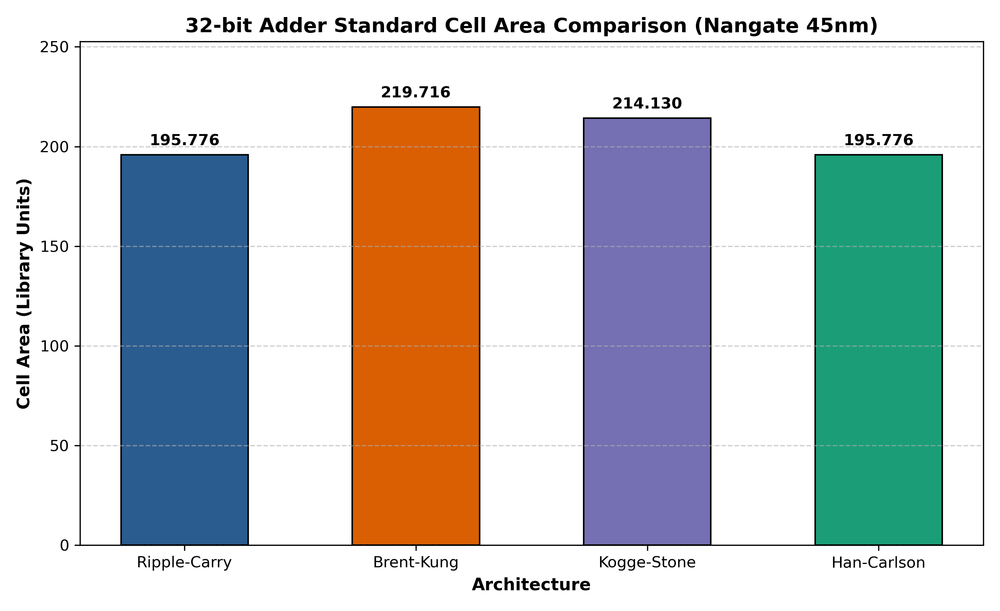
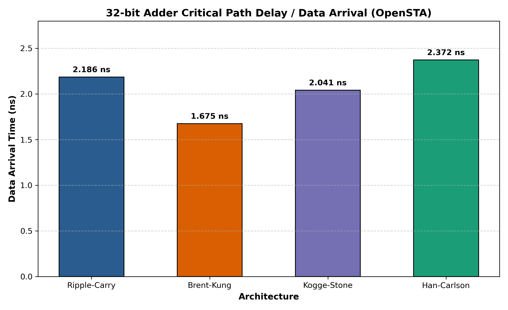
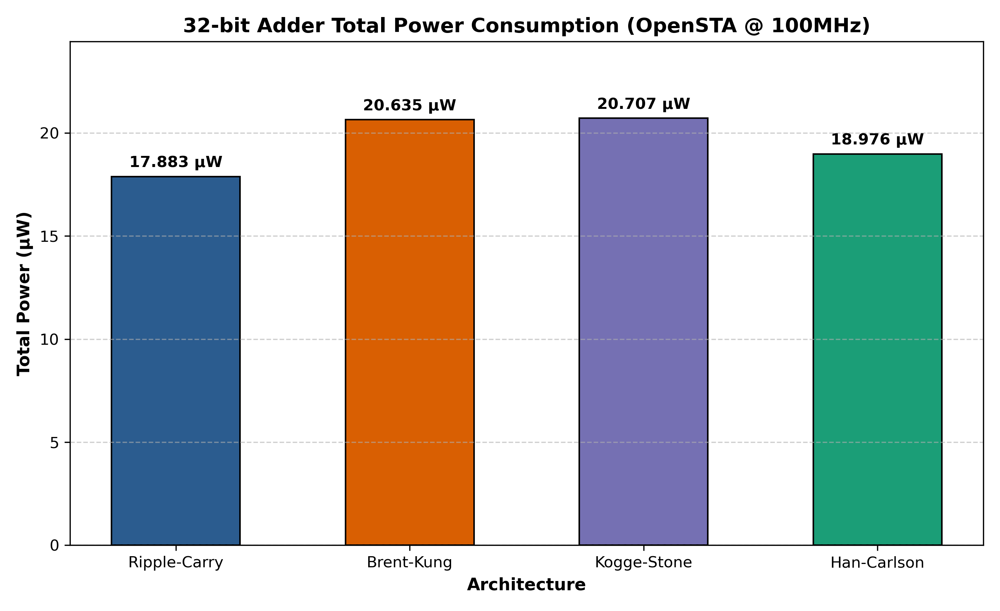
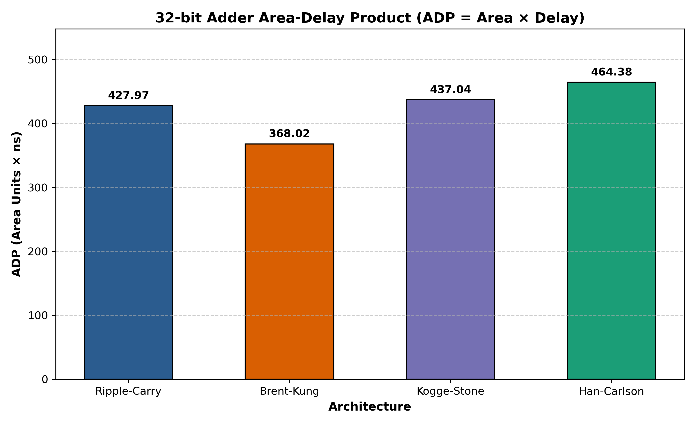

# Comparative Analysis of 32-bit Adder Architectures

An end-to-end digital ASIC benchmarking and verification project comparing four combinational 32-bit binary adder architectures in **Verilog HDL**:

1. **Ripple-Carry Adder (RCA)** — Linear bit-by-bit carry propagation; minimal area baseline.
2. **Brent–Kung Adder (BKA)** — Sparse parallel-prefix tree balancing logic depth and wiring density.
3. **Kogge–Stone Adder (KSA)** — Dense parallel-prefix network with minimum logarithmic prefix depth.
4. **Han–Carlson Adder (HCA)** — Modern hybrid parallel-prefix network combining Brent–Kung outer stages with Kogge–Stone inner stages.

All architectures implement a standardized interface: `A[31:0]`, `B[31:0]`, `Cin`, `Sum[31:0]`, and `Cout` with full 33-bit arithmetic precision:
$$\{C_{out}, \text{Sum}[31:0]\} = \{1'b0, A\} + \{1'b0, B\} + C_{in}$$

---

## 📊 Summary of Benchmarked Results

Results measured using **Yosys 0.33 + ABC** logic synthesis and **OpenSTA 3.1.0** static timing analysis mapped to the **Nangate 45nm Open Cell Library** (`lib/nangate_typ.lib`) under common SDC constraints (100 MHz reference, 1.0 ns external delays, 0.1 ns transition, 5.0 fF load):

| Architecture | Formal SAT Proof ($2^{65}$ States) | Sim Errors (100,010 Vectors) | Mapped Cells | Cell Area (Library Units) | Data Arrival ($t_{\text{arrival}}$) | Worst Slack ($t_{\text{slack}}$) | Total Power (@ 100MHz) | Area-Delay Product (ADP) | SDC Timing Status |
| :--- | :---: | :---: | :---: | :---: | :---: | :---: | :---: | :---: | :---: |
| **Ripple-Carry (RCA)** | **PROVED (Q.E.D.)** | **0** | **161** *(Lowest)* | **195.776** *(Smallest)* | 2.186 ns | +6.814 ns | **17.883 μW** *(Lowest)* | 427.966 | **MET** |
| **Brent–Kung (BKA)** | **PROVED (Q.E.D.)** | **0** | 190 | 219.716 | **1.675 ns** *(Fastest)* | **+7.325 ns** *(Best)* | 20.635 μW | **368.024** *(Optimal)* | **MET** |
| **Kogge–Stone (KSA)** | **PROVED (Q.E.D.)** | **0** | 179 | 214.130 | 2.041 ns | +6.959 ns | 20.707 μW | 437.039 | **MET** |
| **Han–Carlson (HCA)** | **PROVED (Q.E.D.)** | **0** | **161** *(Lowest)* | **195.776** *(Smallest)* | 2.372 ns | +6.628 ns | 18.976 μW | 464.381 | **MET** |

---

## 📈 Visual Comparisons

| Cell Area Comparison | Critical Path Timing Comparison |
| :---: | :---: |
|  |  |

| Total Power Consumption | Area-Delay Product (ADP) |
| :---: | :---: |
|  |  |

---

## 🔍 Key Architectural Insights & PPA Trade-offs

1. **Timing Performance:**
   - **Brent–Kung** achieved the lowest propagation delay (**1.675 ns**), outperforming Ripple-Carry by **~23.4%** and Kogge-Stone by **~17.9%**.
   - **Kogge–Stone** achieved **2.041 ns**, approximately **6.6% faster** than Ripple-Carry.
2. **Area Efficiency:**
   - **Ripple-Carry** and **Han-Carlson** tied for the most compact footprint at **161 mapped cells** and **195.78 library area units**.
   - Brent-Kung traded a **+12.2% area overhead** to achieve a **23.4% speedup**.
3. **Power Consumption:**
   - **RCA** consumes the least power (**17.88 μW**), closely followed by **Han-Carlson** (**18.98 μW**).
   - Prefix adders with dense interconnects (BK and KS) dissipate ~20.6 μW – 20.7 μW due to larger internal capacitance and switching nodes.
4. **Figure of Merit (Area-Delay Product):**
   - **Brent–Kung** achieved the most optimal trade-off with an **ADP of 368.024**, demonstrating the best balance between silicon cost and computational throughput.
5. **ASIC Principle:**
   - Theoretical logic depth ($\log_2 N$) does not always guarantee faster mapped timing; gate fan-out loading, cell sizing, and ABC synthesis mapping significantly affect physical performance.

---

## 🛡️ Verification Framework

### 1. Formal Equivalence Verification (100% Mathematical Proof)
- Uses the **Yosys SAT solver** to construct miter circuits comparing each RTL implementation against the golden behavioral specification:
  $$\text{assert}(\{C_{out,\text{uut}}, \text{Sum}_{\text{uut}}\} \equiv \{1'b0, A\} + \{1'b0, B\} + C_{in})$$
- Evaluates the complete $2^{65} \approx 3.69 \times 10^{19}$ state space.
- Result: **All 4 architectures mathematically proved correct with zero counterexamples (Q.E.D.)**. See [`docs/FORMAL_VERIFICATION.md`](docs/FORMAL_VERIFICATION.md).

### 2. Pseudo-Random Regression & Corner Testing
- **Testbench:** `tb/tb_all_adders.v` running under **Icarus Verilog**.
- **Test Suite:** **100,010 total vectors** (10 directed corner-case vectors covering zeroes, all-ones, carry chains, and MSB overflow + 100,000 pseudo-random vectors).
- **Result:** **0 mismatches** across all 100,010 tests.

---

## 📁 Repository Structure

```text
.
├── rtl/
│   ├── ripple_carry_32.v       # 32-bit Ripple-Carry Adder
│   ├── brent_kung_32.v         # 32-bit Brent-Kung Parallel-Prefix Adder
│   ├── kogge_stone_32.v        # 32-bit Kogge-Stone Parallel-Prefix Adder
│   └── han_carlson_32.v        # 32-bit Han-Carlson Hybrid Prefix Adder
├── tb/
│   └── tb_all_adders.v         # Unified self-checking testbench
├── formal/
│   └── verify_formal.ys        # Yosys SAT formal equivalence script
├── constraints.sdc             # SDC timing & electrical constraints
├── sta/
│   ├── sta_rca.tcl             # OpenSTA script with power & timing for RCA
│   ├── sta_bk.tcl              # OpenSTA script with power & timing for BK
│   ├── sta_ks.tcl              # OpenSTA script with power & timing for KS
│   └── sta_hc.tcl              # OpenSTA script with power & timing for HC
├── scripts/
│   ├── run_all.sh              # One-click script for end-to-end execution
│   ├── run_formal.sh           # Runs Yosys SAT formal verification
│   ├── run_sim.sh              # Runs Icarus Verilog regression
│   ├── run_synth.sh            # Synthesizes all 4 adders using Yosys + ABC
│   ├── run_sta.sh              # Executes OpenSTA timing & power analysis
│   ├── summarize_results.py    # Extracts metrics and updates CSV
│   └── plot_results.py         # Generates comparative PNG graphs
├── lib/
│   └── README.md               # Standard-cell library setup instructions
├── reports/
│   ├── adder_comparison.csv    # Consolidated PPA metrics table
│   ├── area_comparison.png     # Standard cell area plot
│   ├── timing_comparison.png   # Critical path delay plot
│   ├── power_comparison.png    # Power consumption plot
│   ├── adp_comparison.png      # Area-Delay Product plot
│   ├── formal_verify.log       # Formal SAT solver logs
│   ├── all_adders_sim.log      # 100,010-vector simulation log
│   ├── *_synth.log             # Yosys synthesis logs
│   └── *_sta.log               # OpenSTA timing & power logs
├── docs/
│   ├── ARCHITECTURES.md        # Mathematical & structural adder details
│   ├── METHODOLOGY.md          # Verification, synthesis, and STA methodology
│   ├── RESULTS.md              # Detailed result analysis & percentages
│   └── FORMAL_VERIFICATION.md  # Formal verification theory & proof details
├── constraints.sdc
├── PROJECT_MANIFEST.txt
├── .gitignore
└── README.md
```

---

## 🚀 Quick Start (Ubuntu / WSL)

### 1. Prerequisites
Ensure the open-source EDA tools are installed:
```bash
sudo apt update
sudo apt install -y iverilog yosys python3 python3-pip
# Install OpenSTA from source or package manager
sta -v
```

### 2. Standard-Cell Library Setup
Place your authorized Nangate 45nm Liberty file as `lib/nangate_typ.lib` (see [`lib/README.md`](lib/README.md)).

### 3. Run the Complete Flow (One-Click)
```bash
chmod +x scripts/*.sh
./scripts/run_all.sh
```

Or run individual steps:
```bash
./scripts/run_formal.sh      # 1. Run formal mathematical verification
./scripts/run_sim.sh         # 2. Run 100,010-vector simulation
./scripts/run_synth.sh       # 3. Synthesize RTL to gate-level netlists
./scripts/run_sta.sh         # 4. Perform static timing and power analysis
python3 scripts/summarize_results.py  # 5. Extract PPA metrics to CSV
python3 scripts/plot_results.py       # 6. Regenerate comparison plots
```

---

## 📜 License
This project is released under the [MIT License](LICENSE).
